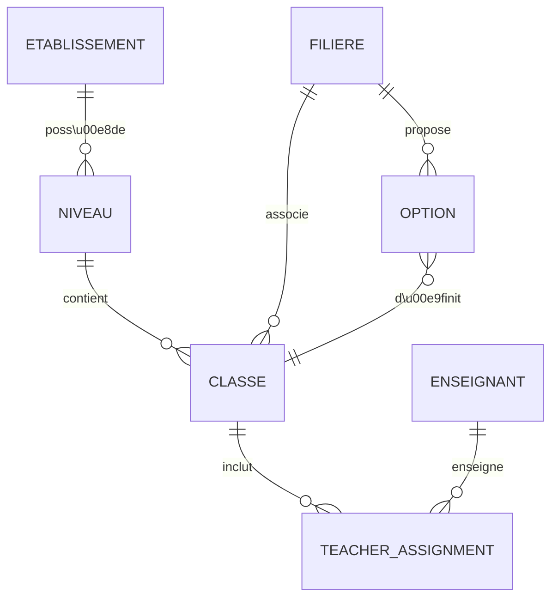
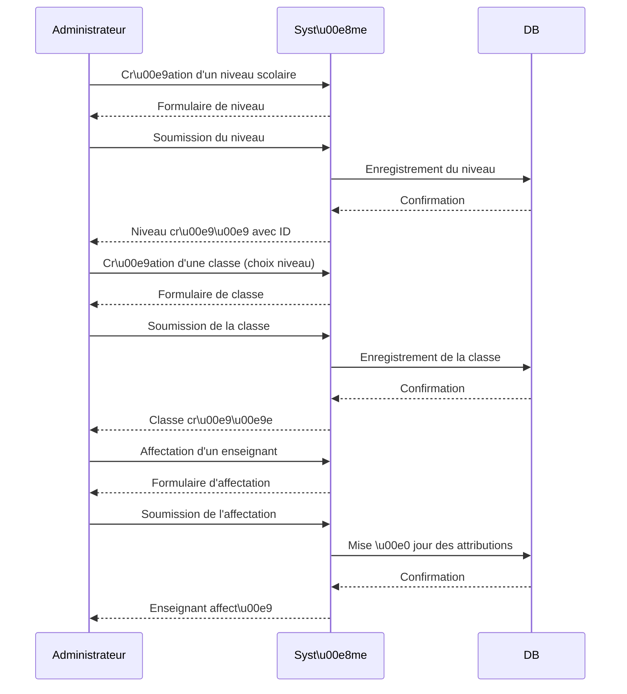

# Résumé exécutif

La fonctionnalité de **gestion des école des classes, niveaux, filières et options**, ainsi que la **gestion globale des enseignants**, vise à centraliser et structurer l’organisation pédagogique dans notre système d’information. Actuellement non implémentée, cette évolution permettra aux administrateurs d’établissements (ou aux super-utilisateurs) de définir les niveaux scolaires (ex. cycles ou grades), les filières (tel que definir dans les fichiers exel), et leurs options associées, puis de créer et organiser les classes en conséquence. Chaque classe pourra être associée à un niveau et à une filière, et des enseignants pourront y être affectés (via des liaisons explicites). Ce développement s’inscrit dans une logique d’harmonisation des données éducatives (inspirée des normes internationales SIF/Ed-Fi) et d’amélioration de la gouvernance scolaire, tout en garantissant performances et sécurité adaptées. 

# Objectifs

## Objectifs fonctionnels

- **Gestion des niveaux** : Créer, modifier, supprimer des niveaux (grades) scolaires. Chaque niveau est identifié (nom, code interne) et rattaché à un établissement. Par exemple : « L1 », « L2 », « M1 ».
- **Gestion des filières et options** : Définir des filières de formation et les options ou modules spécifiques qui s’y rattachent. Une filière peut comporter plusieurs options (ex. « Reseau et Genie informatique (RGI), information et communications(IC)» → options « Maintenace reseau et des systemes informatique(MRSI) », « Assistance systeme et securite reseau (ASSR); Journalisme et communication(JC)»). Ces référentiels doivent pouvoir être maintenus (CRUD).
- **Gestion des classes** : Pour chaque établissement, créer/modifier/supprimer des classes. Une classe est caractérisée par  un niveau (niveau scolaire), éventuellement options . Il peut y avoir plusieurs classes au même niveau.(ex. L1 MRSI, L1 ASSR, L1 GRH, L2 MRSI, L3 MRSI, etc ...)
- **Affectation des enseignants** :Creer et gerr les enseignants, Attribuer un ou plusieurs enseignants à chaque classe. il faut gérer leurs affectations aux classes et aux matières.
- **Règles de validation métier** : Assurer que les données sont cohérentes. Par exemple, le nom d’une classe doit être unique au sein d’un établissement, une option ne peut exister sans filière parente, un niveau doit appartenir à une grille de niveaux, etc. On vérifiera aussi les prérequis pour l’affectation d’un enseignant (titre requis, disponibilité).
- **Héritage et contraintes** : Si nécessaire, prévoir l’héritage ou la reprise d’informations (ex. héritage d’un niveau d’étude d’une année sur l’autre), et intégrer les contraintes d’intégrité référentielle (une classe ne peut exister sans niveau associé, etc.).

Ces fonctionnalités s’appuieront sur un modèle de données structuré (inspiré par les normes Ed-Fi) où l’entité *Section* représente l’unité de classe physique, et où les associations *StudentSectionAssociation* et *StaffSectionAssociation* lient respectivement les élèves et les enseignants à une section donnée. Le périmètre exclut par exemple la gestion des emplois du temps détaillés, des inscriptions d’élèves (déjà gérées ailleurs), ou des contenus pédagogiques.  

## Objectifs non fonctionnels

- **Performance et scalabilité** : Le système doit supporter des milliers de classes et centaines d’établissements (charge moyenne estimée). Les requêtes courantes (liste des classes d’une école, recherche de classe, chargement des affectations enseignants) doivent être optimisées et utiliser la pagination si nécessaire. Les API doivent respecter les contraintes de latence (p. ex. réponses en <300ms aux requêtes simples).
- **Sécurité** : Authentification forte et contrôle d’accès rigoureux (voir section Sécurité). Les données sensibles (ex. identité des enseignants) sont protégées et auditées. Usage de protocoles standards (OAuth2, JWT, TLS, etc.).
- **Fiabilité et robustesse** : La fonctionnalité doit être tolérante aux erreurs (messages d’erreur clairs, validation côté serveur), et les opérations critiques (création d’une filière, suppression de niveau) doivent pouvoir être validées/confirmées par l’utilisateur.
- **Maintenabilité** : Code modulaire, respect des bonnes pratiques de conception (API REST bien nommées selon les ressources métier, tests unitaires automatisés, documentation de l’API).
- **Interopérabilité** : S’appuyer sur les standards internationaux si possible (SIF/Ed-Fi pour les échanges de données éducatives). L’API (REST ou GraphQL) doit être conçue pour s’intégrer facilement avec d’autres systèmes (SIRH enseignants, portails pédagogiques, etc.).
- **Accessibilité et UX** : Les interfaces d’administration seront ergonomiques et conformes aux recommandations d’accessibilité (WCAG AA). La cohérence de l’interface avec le reste de la solution est requise.

# Périmètre

**Inclus** :
- Entités suivantes : *Établissement scolaire*, *Niveau* (grade), *Filière*, *Option*, *Classe*, *Enseignant* (partie affectation), *Affectation enseignant*.
- Opérations CRUD (Créer, Lire, Mettre à jour, Supprimer) pour niveaux, filières, options et classes.
- Fonctionnalité d’affectation et de retrait d’enseignants aux classes.
- Règles de validation métier (unicité, consistance hiérarchique, etc.).
- Modèle de données étendu et API REST/GraphQL correspondante.
- Interfaces d’administration (écrans Web de gestion).
- Scénarios et cas d’usage décrits (diagrammes).
- Sécurité : gestion des rôles/utilisateurs et journalisation des actions.
- Plan de migration de données existantes (depuis l’ancien système qui n’avait pas cette fonctionnalité).

**Exclus** :
- Gestion détaillée d’emploi du temps ou de salles (planning), qui reste hors sujet ici.
- Gestion des élèves (inscriptions, présences) qui supposément existe déjà.
- Gestion des matières ou programme détaillé par classe (sauf via filière option).
- Fonctionnalités pédagogiques avancées (notes, évaluations), hors sujet.
- Aspects infrastructurels (hébergement) autre que les dépendances techniques (voir dépendances).

# Exigences métiers

- **Création/Modification/Suppression** : Un administrateur doit pouvoir créer un niveau ou une filière depuis un formulaire dédié. Par exemple, « 1ère STL » comme filière du niveau « Première ». De même, création d’une classe avec nom, niveau, filière et options éventuelles. La suppression d’un niveau ou d’une filière doit être possible seulement si aucune classe ne leur est rattachée (contrainte d’intégrité). Les mises à jour doivent être versionnées ou validées (avec traces pour audit).
- **Affectation d’enseignants** : On associera un enseignant à une classe via une entité d’affectation. Un enseignant peut avoir plusieurs classes (éventuellement à niveaux différents). Des règles de validation peuvent s’appliquer (p.ex. un enseignant titulaire d’une matière doit coïncider avec la matière principale de la classe). Au moins un « professeur principal » par classe est recommandé. Le système doit vérifier l’existence de l’enseignant dans la base avant affectation.
- **Règles de validation** : Chaque entité a ses contraintes métier. Par exemple, un *Niveau* aura un nom unique par établissement et peut avoir un ordre (pour les hiérarchiser). Une *Filière* doit être attachée à un niveau, et son nom unique dans ce niveau. Une *Option* est liée à une filière, et ne peut être affectée qu’à des classes appartenant à cette filière. Une *Classe* doit référencer un niveau (et filière, option) valide, et son nom (ex. « 2B ») doit être unique dans l’établissement et cohérent (ex. ne pas mélanger élèves de « 2ndes » avec classes de « 1ères »). Les dates d’application (p.ex. année scolaire) doivent être gérées si besoin.
- **Héritage** : On pourra prévoir qu’un niveau « 2de » hérite de certains attributs de « 3e » (par exemple, l’ordre ou les règles générales), en s’appuyant sur un objet métier “Niveau parent”. De même, une filière peut hériter d’une filière type (par exemple une filière « CST2D » hérite des caractéristiques de « STI2D » plus une option). Ceci peut être implémenté via des relations hiérarchiques (self-référence) ou en suivant les bonnes pratiques de modélisation éducative.
- **Traçabilité et audit** : Toute création, modification ou suppression d’un élément sensible (classe, filière, affectation, etc.) doit être journalisée (utilisateur, date/heure, avant/après).

Ces exigences seront documentées dans le cahier des charges, avec des cas d’usage détaillés. L’architecture s’inspirera du standard Ed-Fi : par exemple, le concept de *Section* (classe) et d’*association d’enseignant à une section* correspond exactement à ces besoins. Le standard SIF insiste aussi sur l’échange unifié des données *élèves/enseignants/cours*, objectif partagé ici pour l’interopérabilité.

# Modèle de données (a adapter a l'exsistant)

| Entité                   | Attributs clés (id, nom…)           | Relations principales                                   |
|--------------------------|-------------------------------------|---------------------------------------------------------|
| **Etablissement**        | `id`, `nom`, `adresse`, etc.        | Contient plusieurs Niveaux et Classes.                  |
| **Niveau**               | `id`, `nom`, `ordre`, `etablissement_id` | Appartient à un Établissement. <br>Possède plusieurs Classes.  |
| **Filière**              | `id`, `nom`, `niveau_id`            | Rattachée à un Niveau. Propose plusieurs Options. <br>Possède plusieurs Classes.   |
| **Option**               | `id`, `nom`, `filiere_id`           | Rattachée à une Filière. Peut être associée à plusieurs Classes. |
| **Classe**               | `id`, `nom`, `niveau_id`, `filiere_id`, `option_id(s)` | Rattachée à un Niveau (et éventuellement une Filière/Option). <br>Contient plusieurs affectations d’enseignants (see TeacherAssignment). |
| **Enseignant**           | `id`, `nom`, `prénom`, `email`, etc.| Peut être associé à plusieurs Classes via TeacherAssignment. |
| **TeacherAssignment**    | `id`, `enseignant_id`, `classe_id`, `rôle` | Table de liaison enseignant–classe (e.g. prof principal, suppléant). |

Ce modèle respecte les dépendances : une **Classe** ne peut exister sans **Niveau** ni **Etablissement**. Une **Filière** est liée à un Niveau; une **Option** est dépendante d’une filière. L’entité de liaison **TeacherAssignment** permet de gérer plusieurs enseignants par classe. Les clés étrangères et contraintes doivent être définies pour assurer l’intégrité (par exemple `classe.niveau_id` doit référencer un niveau valide dans le même établissement).



# API REST/GraphQL suggérée

Pour exposer ces fonctionnalités, on peut proposer une API REST (ou GraphQL) s’appuyant sur les ressources métier. Par exemple :

- **/etablissements** (GET, POST) : lister/créer des établissements.  
- **/etablissements/{id}/niveaux** (GET, POST, PUT, DELETE) : gérer les niveaux d’un établissement.  
- **/niveaux/{id}/filieres** (GET, POST, PUT, DELETE) : gérer les filières rattachées à un niveau donné.  
- **/filieres/{id}/options** (GET, POST, PUT, DELETE) : gérer les options d’une filière.  
- **/etablissements/{id}/classes** (GET, POST) : lister/créer des classes dans un établissement.  
- **/classes/{id}** (GET, PUT, DELETE) : détail/modification/suppression d’une classe. Le JSON de classe contiendra les liens vers niveau, filière, option.  
- **/enseignants** (GET, POST) : gestion des enseignants (s’ils ne sont pas déjà exposés).  
- **/classes/{id}/enseignants** (GET, POST, DELETE) : gérer les affectations d’enseignants à cette classe. Exemple de JSON pour créer une affectation :  
  ```json
  {
    "enseignantId": 1234,
    "classeId": 5678,
    "role": "PROF_PRINCIPAL"
  }
  ```  
- En GraphQL, on pourrait avoir des types `Etablissement`, `Niveau`, `Filiere`, `Option`, `Classe`, `Enseignant`, et des mutations comme `createClasse`, `updateFiliere`, etc. 

Les endpoints respecteront les bonnes pratiques : ressources clairement nommées, utilisation des verbes HTTP appropriés (GET, POST, PUT, DELETE) et codes de statut REST standard. Par exemple, `POST /classes` crée une classe et renvoie HTTP 201 avec le nouvel ID, `DELETE /niveaux/{id}` renverra 400 si le niveau n’est pas vide.

# Interfaces UI/UX principales

Pour l’administration, prévoir des écrans web simples et hiérarchisés :

- **Tableau de bord école** : liste des niveaux existants, filières et classes par niveau. Boutons « + Niveau », « + Filière », « + Classe ».  
- **Formulaire Niveau** : saisir nom du niveau, ordre, confirmer.  
- **Formulaire Filière** : choisir niveau parent, nom de la filière.  
- **Formulaire Option** : choisir filière parente, nom de l’option.  
- **Formulaire Classe** : choisir niveau, puis éventuellement filière et option(s), nom de la classe, capacité maximum.  
- **Écran de liste des Classes** : pour chaque classe, affichage du nom, du niveau/filière, et liste des enseignants affectés. Bouton « + Affecter enseignant » ouvre un dialogue.  
- **Formulaire Affectation** : sélection d’un enseignant (autocomplete) et spécification du rôle.  
- **Gestion des enseignants** : un écran annuaire d’enseignants avec possibilité de filtre et création (en tant que CRUD secondaire).  

Les flux UX doivent guider l’utilisateur étape par étape (par ex. choix du niveau dans la création de classe). Les validations inline (nom déjà pris, champs obligatoires) éviteront les erreurs. Les permissions limiteront l’accès (voir section Sécurité). On peut utiliser des normes UI REST/GraphQL pour la cohérence (par ex. OpenAPI pour générer des formulaires dynamiques si on veut).

# Cas d’utilisation et scénarios

1. **Cas : Création d’une nouvelle classe**. L’administrateur clique « + Classe » sur une école. Il choisit le niveau (ex. 3ème), la filière (ex. Technologique), puis l’option (s’il y en a). Il entre le nom de la classe (ex. « 3TECH2 ») et confirme. Le système vérifie l’unicité et crée la classe.  

2. **Cas : Affecter un enseignant**. Sur la fiche d’une classe existante, l’admin clique « Affecter enseignant », choisit un nom dans la liste d’enseignants, définit son rôle (professeur principal, etc.) et valide. L’enseignant apparaît lié à cette classe. Il peut y avoir plusieurs enseignants.

3. **Scénario de suppression**. L’administrateur veut supprimer la filière « Sciences ». Le système bloque l’opération si des classes existent encore dans cette filière. Il faut d’abord retirer ces classes ou les réaffecter.

4. **Flux d’ajout complet (diagramme)** : en français, un flux simplifié de création de niveau puis de classe puis d’affectation.  



Les cas ci-dessus concernent typiquement un rôle « Administrateur » ou « Chef d’établissement ». Un enseignant authentifié pourrait avoir accès, en lecture seule, à ses classes affectées et aux données, mais sans pouvoir modifier la structure.

# Sécurité et gestion des droits

- **Rôles** : Au minimum, prévoir les rôles « Administrateur » (ou Gestionnaire) de l’école, et « Enseignant ». L’administrateur a tous les droits CRUD sur niveaux, filières, classes et affectations. L’enseignant peut uniquement consulter ses propres classes/sections (via StaffSectionAssociation) et éventuellement mettre à jour son profil. 
- **Permissions** : Implémenter une séparation fine : seuls certains groupes (ex. Direction d’école) peuvent créer des niveaux ou filières. Les actions critiques (suppression) peuvent nécessiter une double validation. 
- **Authentification** : Utiliser OAuth2/JWT pour l’API REST, ou un système de session sécurisé pour l’interface. Les tokens JWT doivent porter les rôles utilisateurs. 
- **Contrôle d’accès (RBAC)** : Dans l’API, chaque endpoint vérifie le rôle de l’utilisateur. Par exemple, un enseignant ne peut pas appeler POST /classes ; une API de données (GET /classes) peut être restreinte par filtre « classes où user == enseignant_id ». 
- **Audit** : Toute modification de données sensibles est loggée (utilisateur, timestamp, opération). Un journal d’audit permet de retracer qui a modifié quoi. 
- **Conformité** : Le système respecte la RGPD pour les données personnelles des enseignants (cryptage éventuel des données sensibles au repos). 

# Plan de migration des données existantes

Pour migrer le statu quo vers ce nouveau modèle : 

- **Analyse des données existantes** : Extraire les informations actuelles (s’il y a des champs « classe » ou « groupe » dans l’ancienne base, ou un tableau Excel des classes).  
- **Mapping** : Déterminer comment correspond chaque entité migrée. Par ex., transformer « Classe 5A (Niveau=5e, Filière=Général) » en un enregistrement *Classe* avec les clés niveau_id et filiere_id correspondantes.  
- **Scripts de migration** : Écrire des scripts (Python, SQL) qui, dans l’ordre, créent les niveaux puis les filières puis les classes et enfin affectent les enseignants. Par exemple :  

  1. `INSERT INTO Niveaux (nom, ordre, etablissement_id) VALUES ('6e', 1, 123);`  
  2. `INSERT INTO Filieres (nom, niveau_id) VALUES ('Générale', 1234);`  
  3. `INSERT INTO Classes (nom, niveau_id, filiere_id) VALUES ('6eA', 1234, 5678);`  
  4. Puis assigner enseignant principal : `INSERT INTO TeacherAssignment (enseignant_id, classe_id, role) VALUES (9012, 3456, 'PROF_PRINCIPAL');`  

- **Étapes intermédiaires** : Mettre l’application en mode maintenance, importer les données puis vérifier l’intégrité (rapporter les erreurs d’insertion). Un script de rollback doit être prévu en cas d’échec.  
- **Validation de la migration** : Vérifier après migration que les comptes de classes/enseignants correspondent (reports, totale des classes par niveau).  

# Tests automatisés et critères d’acceptation

- **Tests unitaires** : Couvrir chaque contrôleur d’API (échec et succès), chaque service métier (validation de nom, unicité). Par exemple, tester que `POST /classes` crée bien une classe valide et refuse une classe en doublon.  
- **Tests d’intégration** : Scénarios end-to-end : création d’un niveau + filière + classe + affectation, puis requête GET pour vérifier l’existence. Utiliser des bases de test séparées.  
- **Tests fonctionnels (BDD)** : Scénarios utilisateur (BDD/Gherkin) tels que « Étant donné qu’aucun niveau n’existe, quand j’ajoute le niveau X, alors il apparaît dans la liste ». Critères d’acceptation formels à définir (ex. « Création d’une classe : 200 OK et nouvel ID » ; « Suppression de niveau sans classe : 204 No Content »).  
- **Tests de sécurité** : Vérifier qu’un utilisateur non autorisé ne peut pas créer de classe (retour 403). Tests de robustesse (injections SQL, etc).  
- **Tests de performance (smoke)** : Charger la liste des classes pour un grand établissement (par ex. 1000 classes) et vérifier le temps de réponse. Exécuter des tests de charge légers pour anticiper les besoins.  

# Charge et performance attendues

- **Estimation de charge** : On suppose X établissements (par ex. 100 écoles), chacune avec Y niveaux (10), Z classes par niveau (5), pour un total de 100*10*5 = 5000 classes. Avec 1 à 3 enseignants par classe, soit ~15000 enregistrements TeacherAssignment. Ces ordres de grandeur orientent la conception (index sur niveau_id, etc).  
- **Capacité serveur** : L’API doit pouvoir supporter au moins 10 requêtes/s en pic pour l’administration, plus de l’ordre de 100/s en consultation (mobilité). La DB choisie (PostgreSQL/MySQL) devra être correctement indexée (clefs étrangères, index sur colonnes de recherche).  
- **Caching** : Les données de référence (listes de niveaux, filières) changent peu; on peut éventuellement mettre en cache ces listes pour améliorer la réactivité.  
- **Évolutivité** : Prévoir la possibilité de partitionner par établissement si la volumétrie explose (sharding virtuel par id d’école).  
- **Performance UI** : Les pages web listant les classes seront paginées ou chargées dynamiquement pour éviter les ralentissements.  

# Livrables, jalons et estimation de temps

- **Livrables** : Cahier des charges finalisé, modélisation UML/données, spécification API (ex : fichier OpenAPI/Swagger), maquettes UI, code de développement, scripts de migration, jeux de tests et documentation technique.  
- **Jalons** (exemple pour 3 mois projet) :  
  1. **Analyse et conception (2 sem.)** : Recensement des besoins, définition du modèle de données, écriture du cahier des charges détaillé (CE).  
  2. **Développement backend (4 sem.)** : Création des entités DB, API CRUD, services métier et logique d’affectation.  
  3. **Développement frontend (3 sem.)** : Création des écrans de gestion (formulaires, listes).  
  4. **Intégration et tests (2 sem.)** : Tests unitaires/intégrés, corrections de bugs.  
  5. **Recette & déploiement (1 sem.)** : Phase de validation par les utilisateurs et mise en production.  

  *Estimation de charge par tâche* : environ 2–3 jours pour chaque entité majeure (niveau, filière, classe, affectation) en dev backend, 1–2 jours pour chaque vue UI correspondante, plus environ 5 jours pour intégration/test complet. Ces chiffres sont indicatifs et dépendront du framework utilisé.  
- **Responsabilités** : Identifier un chef de projet/analyste (pour coordonner), un développeur backend, un développeur frontend, un testeur.

# Dépendances techniques et priorités

- **Dépendances** : Le développement repose sur le système d’authentification existant (renvoyer les rôles, user id). Il faudra peut-être étendre la base de données existante ou créer les nouvelles tables (prévoir script ALTER si nécessaire). Vérifier les versions des frameworks web (Java/Spring, Node.js/Express, etc.) pour être cohérent.  
- **Priorités** : D’abord le modèle de données et l’API (backend), car le frontend en dépend. La validation des règles métiers et la sécurité sont prioritaires (écrire les tests associés dès le début).  
- **Risques** : Conflits de noms/désignations (uniformiser la terminologie « niveau » vs « grade », etc.), réutilisation des données historiques (vérifier la qualité des anciens fichiers).  

# Sources à privilégier

Pour guider cette conception, on recommandera en priorité les sites officiels et normes du domaine éducatif : par exemple, les standards **SIF**/Ed-Fi qui définissent les données d’organisation scolaire. Le standard Ed-Fi décrit explicitement les entités *Course*, *CourseOffering*, *Section* et leurs associations, ce qui correspond bien aux concepts de cours, classes et affectations d’enseignants. On consultera également les sites ministériels d’éducation (ex. documentation du MEN, sites UNESCO ou OECD sur les systèmes scolaires) pour les définitions de niveaux/filieres en vigueur. Enfin, pour la conception de l’API, on se réfèrera aux bonnes pratiques REST (via OpenAPI/Swagger) et aux guides techniques (par exemple, modèles d’URI claires et usage correct des verbes HTTP).

**Références essentielles :** documentation Ed-Fi (Teaching & Learning Domain), infos SIF/DESE sur l’interopérabilité des données éducatives, guide de conception API REST.